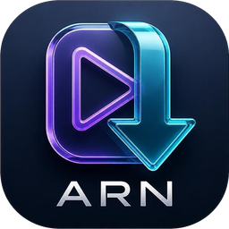

# 📥 تطبيق ARN Video Downloader المتكامل (منظومة تنزيل ومعاينة الفيديوهات)
### ARN Video Downloader — Ultimate High-Performance Desktop Media Downloader

<div align="center">



**الإصدار:** v1.0.0 • **المطور:** عبده رجب نصار • **الشركة:** ARN Technology  
**الهوية:** تصميم عصري فاخر (Dark Glassmorphic UI) مع أداء عالي وسرعة استجابة فائقة.

[](https://www.electronjs.org/)
[](https://react.dev/)
[](https://www.typescriptlang.org/)
[](https://tailwindcss.com/)
[](LICENSE)
[](build_and_sign.ps1)

</div>

---

## 🌟 نظرة عامة عن المنظومة (Overview)

تطبيق **ARN Video Downloader** هو منظومة سطح مكتب متطورة فائقة السرعة والأداء لتحميل الوسائط والفيديوهات من مختلف المنصات العالمية (YouTube، وغيرها) بجودات فائقة تصل إلى 4K، مع استخراج المقاطع الصوتية MP3 بدقة نقية، ومعاينة الفيديوهات لحظياً داخل مشغل مدمج، وحجب تلقائي تام للإعلانات.  
تم بناء التطبيق بهندسة حديثة تعتمد على **Electron** و **React 18** و **TypeScript** مع محرك التنزيل العالمي **yt-dlp** ومعالج الوسائط **FFmpeg**، ومغلف بتصميم زجاجي داكن (Dark Glassmorphism) يمنح المستخدم تجربة بصرية وانسيابية استثنائية.

---

## ✨ الميزات الرئيسية (Core Features)

1. 🔍 **البحث الذكي والتحليل الفوري (Smart Search & Extraction):**
   - إمكانية البحث عن أي فيديو مباشرة داخل التطبيق أو إدراج الروابط المباشرة.
   - استخراج وتفصيل كافة الجودات المتاحة للفيديو (من 360p وحتى 4K Ultra HD و 60fps) وصيغ الصوت المتعددة.

2. 🎬 **مشغل مدمج للمعاينة وحظر الإعلانات (Ad-Free In-App Player):**
   - معاينة وتشغيل الفيديوهات مباشرة داخل التطبيق قبل أو أثناء التنزيل.
   - حجب تلقائي لكافة الإعلانات المزعجة وتخطي النوافذ الترويجية بذكاء.

3. ⚡ **محرك تنزيل متزامن عالي السرعة (Multi-threaded Engine):**
   - إدارة طوابير تنزيل متعددة في نفس الوقت دون التأثير على استقرار النظام.
   - عدّاد سرعة تناظري ورقمي حي (Real-time Speedometer) يوضح سرعة النقل الحقيقية ونسبة التقدم بدقة أجزاء الثانية.
   - تحكم مرن: إيقاف مؤقت، استئناف التنزيلات المتقطعة، أو الإلغاء الفوري.

4. 📑 **دعم شامل لقوائم التشغيل (Full Playlist Support):**
   - تحميل قوائم التشغيل والألبومات بالكامل بنقرة واحدة مع ترقيم وتصنيف تلقائي للملفات.

5. 🎵 **استخراج الصوت الاحترافي (Audio-Only Conversion):**
   - تحويل المقاطع الصوتية إلى صيغ عالية النقاء (MP3, M4A) بترميز احترافي عبر FFmpeg.

6. 🌐 **واجهة عربية أصيلة وعالمية (Native RTL Support):**
   - دعم كامل وتلقائي لاتجاه الواجهة العربي (RTL) مع خطوط عصرية أنيقة وثيم داكن راقي للعين.

---

## 🛠️ التقنيات المستخدمة (Tech Stack)

- **Electron** — إطار عمل تطبيقات سطح المكتب متعددة المنصات.
- **React 18 & TypeScript** — واجهة مستخدم تفاعلية آمنة وسريعة.
- **Vite & electron-vite** — بيئة تجميع فائقة السرعة وخفيفة الحجم.
- **Tailwind CSS** — نظام تصميم عصري مع أنماط Glassmorphic داكنة.
- **Zustand** — إدارة الحالة اللامركزية للتنزيلات والواجهة.
- **yt-dlp & FFmpeg** — أقوى محركات فك التشفير ومعالجة الوسائط على مستوى العالم.

---

## 📁 الهيكلية البرمجية للمشروع (Project Structure)

```
ARN-Video-Downloader/
├── src/
│   ├── main/                    # المعالجة الخلفية لـ Electron
│   │   ├── index.ts             # نقطة الانطلاق الرئيسية وإدارة النوافذ
│   │   ├── download-manager.ts  # محرك إدارة وتتبع طوابير التنزيل
│   │   ├── ad-blocker.ts        # نظام حجب الإعلانات المتقدم
│   │   ├── local-server.ts      # خادم البث المحلي السريع
│   │   ├── tray.ts              # إدارة أيقونة شريط المهام (System Tray)
│   │   └── ipc-handlers.ts      # معالجات قنوات الاتصال الداخلي (IPC)
│   ├── preload/                 # طبقة الأمان وعزل السياق (Context Isolation)
│   │   └── index.ts             # ربط واجهات الـ API الآمنة
│   └── renderer/                # واجهة المستخدم الأمامية (React 18)
│       ├── App.tsx              # التطبيق الرئيسي
│       ├── components/          # المكونات الزجاجية (Speedometer, Search, Queue...)
│       ├── hooks/               # خطافات إدارة الحالة والبحث
│       └── store/               # متاجر Zustand لإدارة التنزيلات
├── resources/                   # أيقونات وملفات التشغيل التنفيذية
│   ├── logo.png                 # شعار المنظومة ثلاثي الأبعاد
│   └── bin/                     # أدوات المعالجة (yt-dlp.exe & ffmpeg.exe)
├── build_and_sign.ps1           # سكربت التجميع والتوقيع الرقمي المعتمد لـ ARN Technology
├── installer.iss                # سكربت حزمة التثبيت الاحترافية (Inno Setup)
├── package.json                 # الحزم والاعتماديات
├── electron.vite.config.ts      # تكوين Vite و Electron
└── tsconfig.json                # إعدادات TypeScript
```

---

## 🚀 التثبيت والتشغيل (Quick Start)

### 1. تثبيت الاعتماديات البرمجية
```bash
npm install
```

### 2. تشغيل التطبيق في وضع التطوير (Dev Mode)
```bash
npm run dev
```

### 3. بناء وتجميع حزمة التثبيت المعتمدة (Build & Sign)
لتجميع التطبيق وتوقيعه رقمياً بشهادة أمان ARN Technology وتوليد ملف التثبيت:
```powershell
.\build_and_sign.ps1
```
أو عبر npm:
```bash
npm run build
npm run dist:win
```

---

## 🔒 الأمان والموثوقية (Security)

- **Context Isolation & Sandbox:** فصل تام بين معالجة النظام وواجهة المستخدم لضمان أعلى معايير أمان المتصفح.
- **التوقيع الرقمي المعتمد:** التطبيق مُوقّع رقمياً بشهادة معتمدة من **ARN Technology** ومختوم بطابع زمني **RFC-3161** لتخطي تحذيرات SmartScreen و Smart App Control.

---

## 📄 الترخيص وحقوق الملكية (License)

جميع الحقوق محفوظة © 2026 لشركة **ARN Technology** والمطور **عبده رجب نصار**.  
يُحظر نسخ أو تعديل أو إعادة توزيع هذا البرنامج أو أي جزء من شيفرته المصدرية دون إذن كتابي مسبق.  
راجع ملف [LICENSE](LICENSE) لمزيد من التفاصيل.
